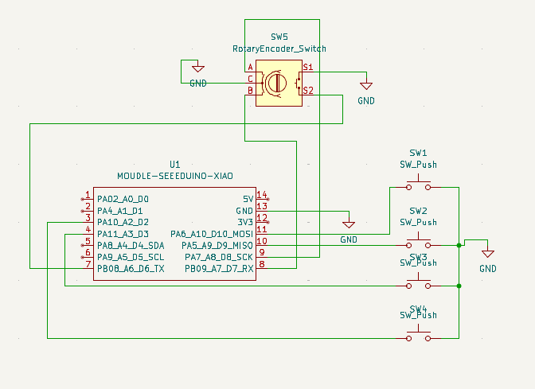
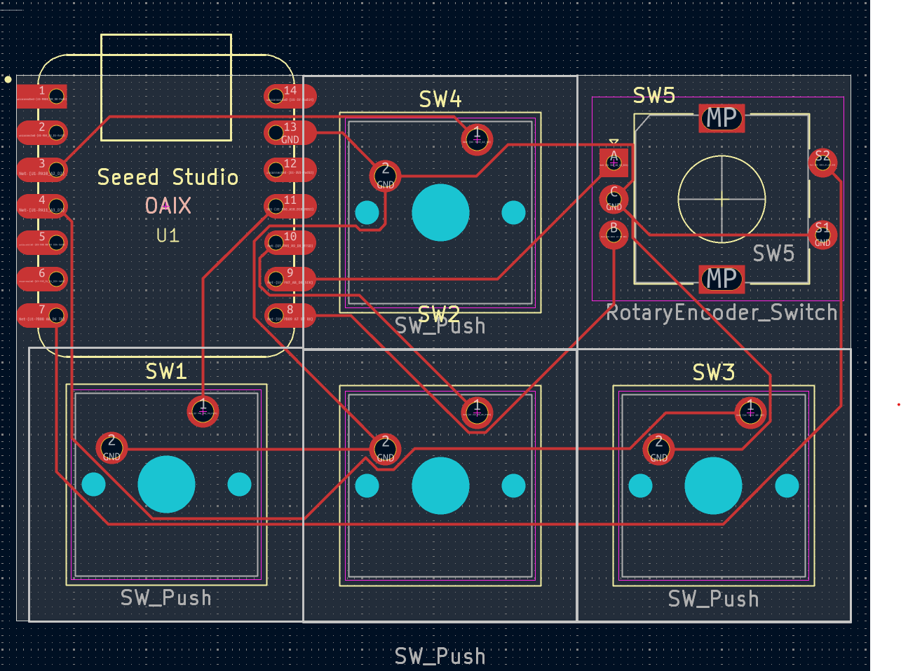
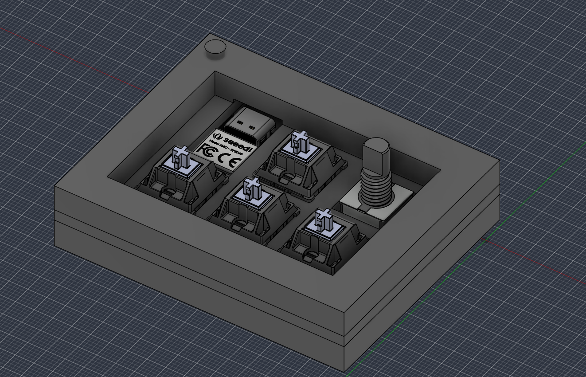

This is my hackpad!

My hackpad has 4 keys in the WASD layout (with one key in the first row and 3 keys in the second row) and a rotary encoder. It uses KMK for its firmware.

I designed this by following [Hackpad](https://hackpad.hackclub.com) and took inspiration from [Orpheuspad](https://github.com/qcoral/orpheuspad)

# Features

4 Cherry MX-style keys
A EC11 rotary encoder for volume (or whatever else you'd like)

# BOM

- 1x PCB
- 1x case
- 4x Cherry MX-style switches
- 1x EC11 Rotary Encoder
- 6x DSA keycaps
- 1x XIAO RP2040
- 4x M3x16mm screws
- 4x M3x5mx4mm heatset inserts

# Schematic

# PCB

# Case

